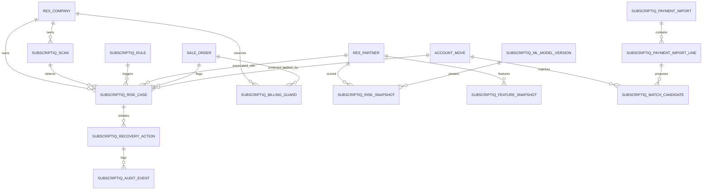

# SubscriptIQ — Database Design & Schema Architecture

## 1. Architectural Philosophy
SubscriptIQ follows a zero-redundancy, high-integrity relational design extending native Odoo models while maintaining isolated, high-performance assurance tables. 

All monetary calculations are backed by strict decimal numeric fields (`digits=(16, 2)` or `digits=(16, 4)`), avoiding floating-point imprecision. Auditability is guaranteed through cryptographically chained, tamper-evident SHA-256 event logs.

---

## 2. Entity Relationship Overview



---

## 3. Core Tables & Extended Models

### 3.1 Extended Native Odoo Models

#### `res.company` (Extended)
- `subscriptiq_active` (Boolean): Enables/disables autonomous guardian scans for the tenant.
- `auto_approval_limit` (Monetary, Default: 500.00): Upper bound for automated, zero-touch recovery actions.
- `dual_authorization_threshold` (Monetary, Default: 5,000.00): Lower bound requiring two distinct manager sign-offs.
- `guardian_scan_interval` (Selection: daily, hourly, continuous): Guardian scan schedule.
- `default_ai_provider` (Selection: groq, gemini, openrouter, local): Active AI inference routing.

#### `product.template` & `product.product` (Extended)
- `is_subscription_product` (Boolean): Classifies item as a recurring revenue product.
- `requires_daily_recurrence` (Boolean): Flag for the daily recurrence billing engine.
- `subscription_addon` (Boolean): Designates product as an optional add-on line.

#### `sale.order` (Subscriptions Adapter)
- `subscriptiq_status` (Selection: `draft`, `quotation`, `confirmed`, `active`, `paused`, `closed`, `expired`): Normalized lifecycle state.
- `subscriptiq_plan_id` (Many2one -> `subscriptiq.plan`): Associated billing terms and recurrence rules.
- `subscriptiq_risk_score` (Float): Real-time calculated churn risk (0–100).
- `subscriptiq_risk_level` (Selection: `low`, `medium`, `high`, `critical`).
- `subscriptiq_billing_hold` (Boolean): Transactional circuit breaker preventing invoice generation.
- `subscriptiq_last_renewal_date` (Date): Historical milestone.
- `subscriptiq_next_renewal_date` (Date): Forward-looking billing target.
- `subscriptiq_consecutive_failed_payments` (Integer): Health metric for risk prioritization.

#### `account.move` (Invoices Extended)
- `subscriptiq_risk_state` (Selection: `unscreened`, `verified_healthy`, `flagged_at_risk`, `recovered`): Financial integrity indicator.
- `subscriptiq_billing_reservation_id` (Many2one -> `subscriptiq.billing.guard`): Atomic reservation token.
- `subscriptiq_recovered_date` (Datetime): Exact reconciliation timestamp for Verified Recovered Revenue KPI.
- `subscriptiq_recovered_amount` (Monetary): Audited recovery amount credited.

---

### 3.2 Revenue Assurance Tables

#### `subscriptiq.scan` (`subscriptiq_scan`)
Tracks discrete execution cycles of the continuous Revenue Guardian scanner.
| Column | Type | Constraints / Description |
|---|---|---|
| `id` | SERIAL | PRIMARY KEY |
| `name` | VARCHAR | Unique sequence (`SCAN-YYYYMMDD-XXXXX`) |
| `state` | VARCHAR | `running`, `completed`, `failed` |
| `started_at` | TIMESTAMP | Execution start timestamp |
| `completed_at` | TIMESTAMP | Execution completion timestamp |
| `duration_ms` | NUMERIC(10,2) | Execution elapsed runtime |
| `records_scanned` | INTEGER | Total volume of records processed |
| `cases_created` | INTEGER | New risk cases discovered |
| `cases_updated` | INTEGER | Pre-existing risk cases modified |
| `revenue_at_risk` | NUMERIC(16,2) | Sum of exposure identified in this run |
| `company_id` | INTEGER | FOREIGN KEY -> `res_company(id)` |

#### `subscriptiq.rule` (`subscriptiq_rule`)
Deterministic business policy definitions driving risk case generation.
| Column | Type | Constraints / Description |
|---|---|---|
| `id` | SERIAL | PRIMARY KEY |
| `code` | VARCHAR | Unique rule key (e.g., `OVERDUE_INVOICE`) |
| `name` | VARCHAR | Human-readable title |
| `rule_type` | VARCHAR | `invoice`, `subscription`, `discount`, `payment` |
| `severity` | VARCHAR | `low`, `medium`, `high`, `critical` |
| `active` | BOOLEAN | Execution switch |
| `auto_recoverable` | BOOLEAN | Whether automated safe actions are permissible |
| `config_json` | TEXT | Dynamic thresholds (e.g. grace periods, days before renewal) |

#### `subscriptiq.risk.case` (`subscriptiq_risk_case`)
Primary anomaly artifact representing a detected revenue leakage risk.
| Column | Type | Constraints / Description |
|---|---|---|
| `id` | SERIAL | PRIMARY KEY |
| `name` | VARCHAR | Unique sequence (`RISK-YYYY-XXXXX`) |
| `rule_id` | INTEGER | FOREIGN KEY -> `subscriptiq_rule(id)` |
| `company_id` | INTEGER | FOREIGN KEY -> `res_company(id)` |
| `partner_id` | INTEGER | FOREIGN KEY -> `res_partner(id)` |
| `subscription_id` | INTEGER | FOREIGN KEY -> `sale_order(id)` (nullable) |
| `invoice_id` | INTEGER | FOREIGN KEY -> `account_move(id)` (nullable) |
| `payment_id` | INTEGER | FOREIGN KEY -> `account_payment(id)` (nullable) |
| `state` | VARCHAR | `open`, `in_recovery`, `resolved`, `dismissed` |
| `severity` | VARCHAR | `low`, `medium`, `high`, `critical` |
| `amount_at_risk` | NUMERIC(16,2) | Verified uncollected or exposed sum |
| `fingerprint` | VARCHAR(64) | SHA-256 deduplication hash |
| `recommended_action` | VARCHAR | Workflow directive |
| `evidence_json` | TEXT | Snapshot of exact variables triggering the rule |
| `detected_at` | TIMESTAMP | Anomaly emergence timestamp |

**Indexes & Constraints:**
- `UNIQUE (fingerprint)`: Strictly prevents duplicate case creation across consecutive scans.
- `INDEX (company_id, state, severity)`: High-performance dashboard queries.

#### `subscriptiq.billing.guard` (`subscriptiq_billing_guard`)
Atomic concurrency control table guaranteeing idempotency during recurring invoice generation.
| Column | Type | Constraints / Description |
|---|---|---|
| `id` | SERIAL | PRIMARY KEY |
| `subscription_id` | INTEGER | FOREIGN KEY -> `sale_order(id)` |
| `company_id` | INTEGER | FOREIGN KEY -> `res_company(id)` |
| `billing_period_start` | DATE | Invoice coverage start date |
| `billing_period_end` | DATE | Invoice coverage end date |
| `idempotency_key` | VARCHAR(64) | Composite SHA-256 hash |
| `state` | VARCHAR | `reserved`, `committed`, `released`, `expired` |
| `invoice_id` | INTEGER | FOREIGN KEY -> `account_move(id)` (nullable) |
| `reserved_at` | TIMESTAMP | Lock acquisition time |

**Indexes & Constraints:**
- `UNIQUE (company_id, subscription_id, billing_period_start, billing_period_end)`: Hard database constraint preventing double billing.
- `UNIQUE (idempotency_key)`: Enforces exact idempotency.

---

### 3.3 Smart Reconciliation & ML Tables

#### `subscriptiq.payment.import` & `subscriptiq.payment.import.line`
Handles unallocated bank statement feeds.
- Normalized raw statement metadata: `statement_reference`, `transaction_date`, `raw_label`, `amount`, `currency_id`, `state` (`unmatched`, `suggested`, `reconciled`, `flagged`).

#### `subscriptiq.match.candidate`
Computed reconciliation pair linking statement lines to outstanding invoices.
- `confidence_score` (Float): Weighted score ($0.00 - 1.00$).
- Scoring breakdown:
  - Exact reference / invoice number match: Weight $0.50$
  - Exact partner name match: Weight $0.30$
  - Exact amount match: Weight $0.15$
  - Date proximity window ($\le 5$ days): Weight $0.05$
- `is_auto_reconciled` (Boolean): Flag set if confidence $\ge 0.85$ and within automated limits.

#### `subscriptiq.ml.model.version` & `subscriptiq.feature.snapshot`
- Maintains model artifact telemetry: `algorithm` (`LogisticRegression` vs `RandomForestClassifier`), `roc_auc_score`, `precision`, `recall`, `brier_score`, `is_champion`.
- Snapshots 10 engineered behavioral features per partner for offline, non-blocking scoring.

---

### 3.4 Tamper-Evident Chained Audit Log

#### `subscriptiq.audit.event` (`subscriptiq_audit_event`)
Every write, status transition, recovery trigger, and manual approval produces an un-editable audit record.
| Column | Type | Constraints / Description |
|---|---|---|
| `id` | SERIAL | PRIMARY KEY |
| `sequence` | BIGINT | Monotonically increasing sequence |
| `timestamp` | TIMESTAMP | Event creation timestamp |
| `event_type` | VARCHAR | `scan`, `risk_detected`, `action_executed`, etc. |
| `user_id` | INTEGER | FOREIGN KEY -> `res_users(id)` |
| `company_id` | INTEGER | FOREIGN KEY -> `res_company(id)` |
| `model_name` | VARCHAR | Target entity |
| `record_id` | INTEGER | Target ID |
| `previous_hash` | VARCHAR(64) | Hash of the immediate predecessor record |
| `payload_hash` | VARCHAR(64) | SHA-256 of `(event_type + user_id + payload_json)` |
| `current_hash` | VARCHAR(64) | SHA-256 of `(previous_hash + payload_hash + timestamp)` |

**Security Guarantee:**
- Overridden `write()` and `unlink()` methods raise native `AccessError("Audit trail records are immutable and cannot be altered or removed.")`.
- Any tampering in the PostgreSQL database breaks the cryptographic hash chain `current_hash[n] == SHA256(current_hash[n-1] + payload)`.

---

## 4. Query Performance Optimizations
1. **Multi-Tenant Composite Indexing**:
   ```sql
   CREATE INDEX idx_subscriptiq_risk_dashboard 
   ON subscriptiq_risk_case (company_id, state, severity, amount_at_risk);
   ```
2. **Partial Indexing on Active Subscriptions**:
   ```sql
   CREATE INDEX idx_sale_order_active_subs 
   ON sale_order (company_id, subscriptiq_next_renewal_date) 
   WHERE subscriptiq_status = 'active';
   ```
3. **Overdue Invoices Acceleration Index**:
   ```sql
   CREATE INDEX idx_account_move_unpaid_overdue 
   ON account_move (company_id, invoice_date_due, amount_residual) 
   WHERE state = 'posted' AND payment_state != 'paid' AND amount_residual > 0;
   ```
