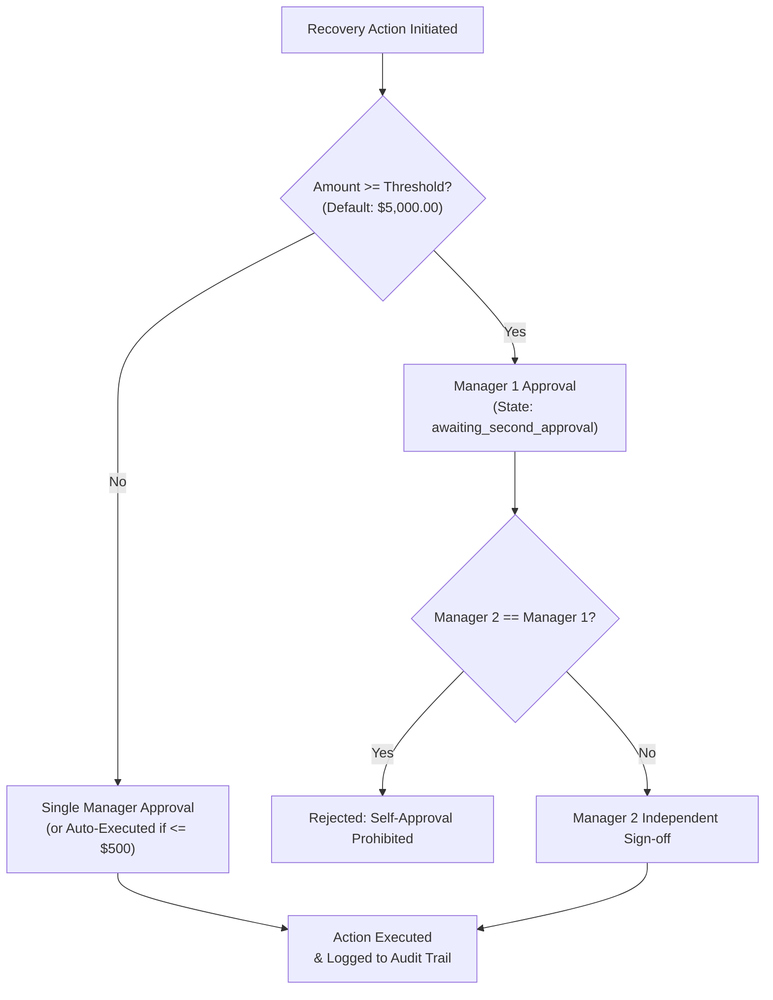

# SubscriptIQ — Security Architecture & Access Control

## 1. Role-Based Access Control (RBAC) Matrix

SubscriptIQ enforces granular separation of duties aligned with financial risk management standards. 5 access tiers are defined in `subscriptiq/security/groups.xml` and enforced through `ir.model.access.csv`.

| Functional Capability | Viewer (`group_viewer`) | Analyst (`group_analyst`) | Operator (`group_operator`) | Manager (`group_manager`) | Admin (`group_admin`) |
|---|:---:|:---:|:---:|:---:|:---:|
| View Revenue Assurance Dashboards | **Read** | **Read** | **Read** | **Read** | **Read** |
| Run Manual Guardian Scans | - | **Execute** | **Execute** | **Execute** | **Execute** |
| View Risk Cases & Anomalies | **Read** | **Read** | **Read** | **Read** | **Read** |
| Export Telemetry & CSV Reports | - | **Execute** | **Execute** | **Execute** | **Execute** |
| Execute Safe Auto-Actions ($\le \$500$) | - | - | **Execute** | **Execute** | **Execute** |
| Propose High-Value Recovery Actions | - | - | **Propose** | **Execute** | **Execute** |
| Approve Standard Recovery ($< \$5,000$) | - | - | - | **Approve** | **Approve** |
| Dual Authorization Sign-Off ($\ge \$5,000$) | - | - | - | **Sign (1 of 2)**| **Sign (1 of 2)** |
| Import & Reconcile Bank Statements | - | **Read** | **Execute** | **Execute** | **Execute** |
| Retrain Churn ML Models | - | **Execute** | - | **Execute** | **Execute** |
| Configure Guardian Rules & Thresholds | - | - | - | **Edit** | **Full Admin** |
| Access & Verify Chained Audit Logs | **Read** | **Read** | **Read** | **Read** | **Verify / Admin** |
| Alter Audit Trail Records | **DENIED** | **DENIED** | **DENIED** | **DENIED** | **DENIED** |

> [!CAUTION]
> Audit logs are strictly immutable across all security groups, including the Odoo `base.group_system` Administrator. Calls to `unlink()` or `write()` on `subscriptiq.audit.event` raise an uncompromising `AccessError`.

---

## 2. Multi-Company & Tenant Isolation

Multi-tenant security is strictly enforced at the database layer via Odoo `ir.rule` record rules in `subscriptiq/security/record_rules.xml`.

### Multi-Company Domain Specification
All assurance models (`subscriptiq.scan`, `subscriptiq.risk.case`, `subscriptiq.billing.guard`, `subscriptiq.payment.import`, `subscriptiq.recovery.action`, `subscriptiq.audit.event`) enforce:

```xml
<record id="subscriptiq_risk_case_company_rule" model="ir.rule">
    <field name="name">SubscriptIQ Risk Case Multi-Company</field>
    <field name="model_id" ref="model_subscriptiq_risk_case"/>
    <field name="domain_force">[('company_id', 'in', company_ids)]</field>
</record>
```

**Guarantees:**
1. Users logged into Tenant A cannot query, view, or trigger recovery actions for records belonging to Tenant B.
2. Background cron jobs evaluate company boundaries per active scan and isolate memory pools.
3. Billing reservation locks are composite keyed on `(company_id, subscription_id, ...)`, preventing cross-company reservation collisions.

---

## 3. Customer Portal Isolation

External customers accessing Brightloop Software through the Odoo Customer Portal (`base.group_portal`) are subject to strict row-level isolation:
1. **Subscriptions (`sale.order`)**: Customers may only read subscriptions where `partner_id = user.partner_id.id`.
2. **Invoices (`account.move`)**: Customers can only inspect posted invoices belonging to their partner ID.
3. **Assurance Internal Models**: Customers possess zero read, write, create, or unlink access to internal tables (`subscriptiq.risk.case`, `subscriptiq.scan`, `subscriptiq.audit.event`, `subscriptiq.billing.guard`). Any attempt to browse these models returns a 403 Forbidden Access Denied exception.

---

## 4. Dual Authorization Workflow

To safeguard financial integrity and prevent internal fraud, recovery operations exceeding defined thresholds require two independent authorizations:



- **Threshold Settings**: Configurable per company (`res.company.dual_authorization_threshold`).
- **Identity Verification**: The second approver (`approved_by_2_id`) must have `res_users.id != approved_by_1_id`.
- **Cryptographic Chaining**: Both user IDs, timestamps, and the action payload are committed into the immutable audit chain.

---

## 5. AI Copilot Defense & Prompt Injection Hardening

The SubscriptIQ Finance Copilot operates with zero-trust perimeter defenses to prevent prompt injection, hallucinated action triggers, and unauthorized data leakage.

### 5.1 Multi-Layer Defense Architecture
1. **Input Sanitization**:
   - Query strings are scrubbed of malicious prompt injection patterns (e.g., `IGNORE PREVIOUS INSTRUCTIONS`, `SYSTEM PROMPT REVEAL`, `AS AN UNRESTRICTED AI`, markdown/HTML tag injections).
   - Queries exceeding 1,000 characters are rejected.
2. **Strict System Prompt Framing**:
   - The Copilot is explicitly framed as an unprivileged financial reporting agent.
   - It is strictly forbidden from executing state-modifying actions without human review.
3. **Tool Whitelisting & Parameter Validation**:
   - The Copilot cannot execute arbitrary Python or SQL.
   - Only whitelisted read tools (`get_revenue_kpis`, `get_open_risk_cases`, `inspect_case_details`, `get_customer_risk_profile`) can be called.
4. **Action Previews Only**:
   - If the Copilot suggests a remediation (e.g. "Trigger Dunning Email"), it generates a structured action preview requiring an authenticated Operator or Manager to click and sign off in the Odoo UI. The LLM never directly mutates database records.

---

## 6. Cryptographic Audit Chain

All critical operations write to `subscriptiq.audit.event`. Each event includes:
$$\text{payload\_hash} = \text{SHA256}(\text{event\_type} \parallel \text{user\_id} \parallel \text{payload\_json})$$
$$\text{current\_hash} = \text{SHA256}(\text{previous\_hash} \parallel \text{payload\_hash} \parallel \text{timestamp})$$

Because each record links to the previous record's hash, any manual alteration of database rows (even via direct SQL access) breaks the validation chain, alerting compliance administrators immediately.
